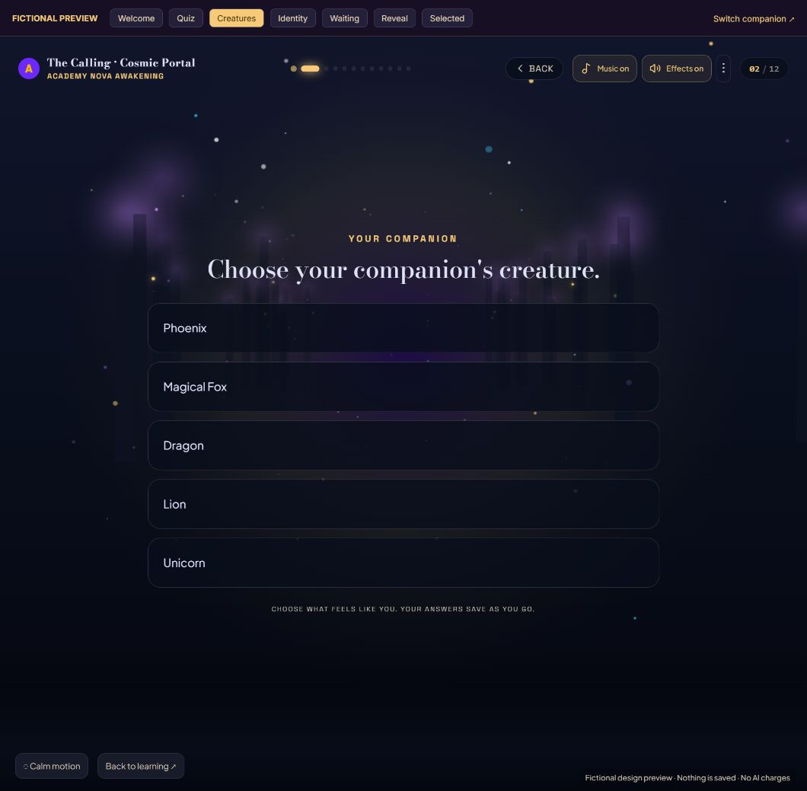
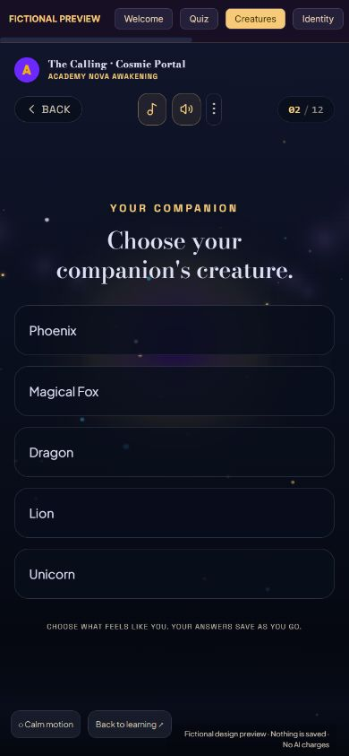
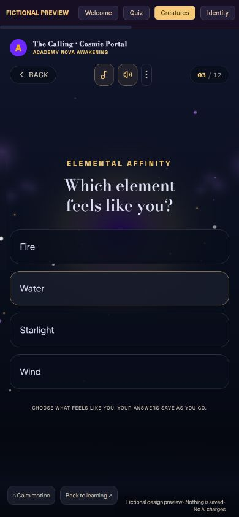

# Nova Studio — audio and creature-selection review

Feature branch: `feature/nova-companion-cards` · Draft PR: [#68](https://github.com/rayyanfaizal39-ai/silken-sheen/pull/68).

This update includes the previous local Google AI Studio visual adaptation and continues it with original static audio, text-only questions, five creature choices and one additional option for each other question. It retains the existing application, server functions and database architecture.

## Preview

- [Question 2 — five text-only choices](http://127.0.0.1:5181/nova/studio?preview=mia&scene=creatures)
- [Complete twelve-question adventure](http://127.0.0.1:5181/nova/studio?preview=mia&scene=quiz)
- [Cinematic opening](http://127.0.0.1:5181/nova/studio?preview=mia&scene=welcome)
- [Identity / summoning ritual](http://127.0.0.1:5181/nova/studio?preview=mia&scene=identity)

These fixtures are clearly marked fictional, operate in memory only and never call Supabase or OpenAI. New visitors start with music and effects off. Use the separate header controls to hear the soundtrack and effects. Saved ON preferences are restored silently until a permitted interaction. The toolbar also provides waiting, ready-egg/reveal and selected-card scenes.

## Creature compatibility

`QUESTIONS[1].options` contains **Phoenix, Magical Fox, Dragon, Lion and Unicorn**, as simple text-only answer rows. Choices use semantic buttons, keyboard activation, touch targets, focus outlines and a selected border. All twelve questions retain their original wording and existing answer labels; no answer contains images, thumbnails, swatches, symbols or extra descriptions.

The retired stored answer `answers[1] === 2` remains valid Phoenix. New choices use stable codes 3 (Dragon), 4 (Lion), 5 (Unicorn); the UI converts visible indexes before saving. The app and worker share `nova-answers.ts`. Raw saved arrays, revisions, immutable identity versions and generated artwork remain untouched. The additive, **unapplied** `20261017102224_nova_creature_variety.sql` expands position-aware validation and SQL trait lookup without changing existing rows, RLS, RPC ownership, generation flags or budgets. Local PostgreSQL tests cover all six stored creature codes, malformed arrays and original identities.

The other eleven questions now have four options. Existing three choices remain in their original order; the additions are:

| Question | Additional option |
| --- | --- |
| Adventure | Protecting something precious (Guardian) |
| Element | Wind |
| Silhouette | Graceful and majestic |
| Colours | Emerald Green / Silver |
| Gift | Winds of courage |
| Habitat | Ancient sky gardens |
| Greeting | Bold and welcoming |
| Eyes | Emerald Aurora Eyes |
| Signature detail | A shimmering spiral |
| Challenge | Trust your instincts |
| Bond | Inspire each other |

Original SVG fallback art now distinguishes Dragon membrane wings/scales/horns, Lion mane/rounded ears/tufted tail and Unicorn spiral horn/mane/hooves. All five earned stages and both Origin variants render. The new emerald palette, eyes and spiral detail are supported. Fictional reveals use the selected traits rather than substituting the original demo animal. These remain SVG prototypes, not approved generated artwork.

## Original audio and licensing

| Asset                                     |                 Size | Contents                                                                                                                                           |
| ----------------------------------------- | -------------------: | -------------------------------------------------------------------------------------------------------------------------------------------------- |
| `public/nova/audio/starlit-sanctuary.mp3` |        412,731 bytes | Original 34.286-second, 56 BPM piano, warm harmonic strings, celestial bells and atmospheric arrangement. Events/reverb wrap at the loop boundary. |
| `public/nova/audio/nova-magic.mp3`        |        237,769 bytes | Original 19.720-second sprite containing fourteen authored effects.                                                                                |
| `public/nova/creatures/*.svg`             | About 20 KB combined | Original source illustrations retained in the repository; no longer displayed or requested by the quiz.                                            |

All listed media were composed/drawn locally for this task, without third-party samples, purchased recordings or paid generation. They are provided under **CC0-1.0**; see [the asset license](../public/nova/LICENSE.md). Authoring sources are `scripts/generate-nova-audio.py` and `scripts/generate-nova-illustrations.mjs`. Numpy/ffmpeg are authoring tools only. No runtime package or lockfile change is required. Externally hosted fictional collectible art from the supplied design is separately documented in [the export review](nova-sanctuary-design-review.md).

The MP3s decode to reusable Web Audio buffers only after audio is enabled and a permitted gesture occurs. One route-owned mixer holds one music loop and one exclusive effects voice. Music starts at 24% gain, fades in over 650 ms and out over 320 ms; volume is capped at 60%. Question rerenders reuse the running loop. Toggle off/on retires a fading source before another starts. Route exit aborts pending loads, stops/disconnects nodes and closes the context. Hidden pages suspend audio and preserve the music offset. Browser refusals, missing assets and blocked localStorage produce a silent fallback without blocking the journey.

Music and effects are independent. Only their preferences/volume are stored in `academy.nova.audio.v1`; quiz answers and identities continue using the existing server flow. Reduced motion is separate from audio preferences.

| Interaction                     | Cue                                                                          |
| ------------------------------- | ---------------------------------------------------------------------------- |
| First permitted entry / return  | `enter` / `welcome`                                                          |
| Option hover or keyboard focus  | `hover` (220 ms rate limit; suppressed during other effects)                 |
| Ordinary answer / next question | `answer` (crystal confirmation with a soft whoosh tail)                      |
| Intro continuation              | `transition`                                                                 |
| Phoenix / Magical Fox           | `phoenix` / `fox` (species texture, confirmation and transition in one clip) |
| Fire / Water / Starlight        | `fire` / `water` / `starlight`                                               |
| Question 12                     | `complete` orchestral flourish                                               |
| SUMMON MY NOVA                  | `summon`                                                                     |
| Egg hatch / permanent bond      | `hatch` / `bond`                                                             |

Effects share a single priority-controlled voice; rapid hovering cannot create an overlapping queue. The music remains independent. No action, progress or error depends on audio alone.

## Interface and preserved behavior

- Source portal, flight, constellations, egg and foil card presentation remain isolated to Nova Studio.
- Every question uses text-only answer rows; artwork is reserved for companion/card presentation.
- Flight transitions take 460 ms; mobile particle/tree counts are lower. Questions load no image assets. Calm mode and OS reduced motion suppress movement.
- The final ritual shows **YOUR NOVA'S DESTINY IS WRITTEN**, every selected trait and the existing identity confirmation step, followed by **SUMMON MY NOVA**. The same server submission then displays **YOUR NOVA IS AWAKENING**, the requested return text and honest pending/ready/error state. No fake generation progress was introduced.
- Saved drafts, twelve-question ordering, subscription rules, Batch requests, two Origin candidates, next-day reveal, permanent selection, serial/QR/barcode, private storage, spending flags and five-stage XP thresholds are retained. No production migration, database change, AI request, merge or production deployment was performed.

## Files changed

| Area                                                  | Files                                                                                                                                                                                                                                                          |
| ----------------------------------------------------- | -------------------------------------------------------------------------------------------------------------------------------------------------------------------------------------------------------------------------------------------------------------- |
| Shared answer compatibility                           | `model.ts`, `studio.server.ts`, model and SQL regression tests                                                                                                                                                                                                 |
| Studio flow / fixtures / copy                         | `StudioPage.tsx`, `StudioMockPreview.tsx`, `studio-model.ts`, `studio.interaction.test.tsx`                                                                                                                                                                    |
| Audio                                                 | `sanctuary/audio.ts`, `audio-cues.ts`, `AudioControls.tsx`, `useSanctuaryPreferences.ts`, `audio.test.tsx`                                                                                                                                                     |
| Text-only questions                                   | `sanctuary/QuestionOptions.tsx`, `questions.ts`, `CinematicFlightWorld.tsx`, `sanctuary.css`, `public/nova/creatures/`                                                                                                                                         |
| Previous visual adaptation included in this PR update | `CinematicOpening.tsx`, `CosmicCanvas.tsx`, `NovaEgg.tsx`, `OriginReveal.tsx`, `ConfettiBurst.tsx`, `SanctuaryHeader.tsx`, `SanctuaryCardPanel.tsx`, `preview-artwork.ts`, `StudioCompletedCard.tsx`, optional `NovaCard.tsx` appearance, route-only font link |
| Authoring / review                                    | Both media scripts, `public/nova/LICENSE.md`, this report, source-design review and screenshots                                                                                                                                                                |

Paths without a prefix in the table are under `src/features/nova-cards/`, except the existing `src/routes/nova_.studio.tsx` route.

## Verification

- **116 tests passed across 11 files**, including 32 local PostgreSQL/RLS tests, complete journeys for all five creatures with fourth-option answers and resume, exact text-only rendering, legacy third-answer preservation, all species/stage SVG rasterization, actual QR/barcode encoding/export, generation/selection/evolution rules, 30 onboarding-route checks and ten audio lifecycle tests.
- Scoped ESLint and the Nova worker TypeScript contract passed.
- Repository TypeScript reports only the two pre-existing science-test errors at `chapter-7-9-10-visual-integration.test.tsx:305` and `chapter-9-heat-visuals.test.tsx:523`; no Nova errors.
- Production build passed: `npm run build` (compile/package only).
- Browser checks use the real local MP3s and Web Audio implementation: music/effect buffers decoded and started after gestures, persisted preferences restored silently after reload, Enter selected Magical Fox, disabling effects retained playing music through answer progression, and the soundless journey remained usable. Automated checks observe successful playback state; audible quality and physical speaker/headphone output remain for human review.
- The five-choice revision was checked at desktop 1060×1039, tablet 768×1024 and mobile 390×844, with no horizontal overflow. All five choices fit on the taller phone; the existing scrollable question surface keeps choices reachable on short screens (375×667). A browser journey also selected Dragon, Wind and the remaining new options through identity review. The phone header uses two compact rows. These are browser viewport checks, not a physical-device test.

